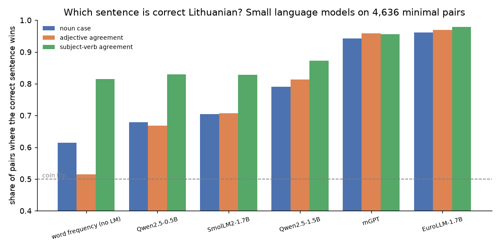

# Does a small LLM know Lithuanian grammar?

Lithuanian has seven cases, three genders and endings that have to agree with each other. Most small open language models are trained mostly on English. I wanted a quick, honest way to see how much Lithuanian grammar they actually picked up.

The test is simple. Take a real Lithuanian sentence, change one word to a wrong form of the same word, and ask the model which of the two sentences it finds more likely. No prompts, no generation, no judging of answers. A model that knows the grammar should prefer the original almost every time.

## The pairs

All sentences come from the [UD Lithuanian ALKSNIS](https://universaldependencies.org/treebanks/lt_alksnis/) treebank (3,642 sentences from news, fiction, legal and science texts, every word tagged with its case, number, gender and so on). From it `build_pairs.py` makes 4,636 pairs of three kinds:

| kind | what changes | example |
|---|---|---|
| noun case | a noun gets another case, same number | ...trys dešimtys GMO **produktų** → **produktais** |
| adjective agreement | an adjective no longer matches its noun | ...viešieji ryšiai, **organizaciniai** modeliai → **organizacinių** modeliai |
| subject-verb agreement | the verb gets another person or number than its subject | ...**sakė** jis → **sakei** jis |

The wrong form is always a real form of the same word that appears somewhere in the treebank, so the model can't spot it just because it looks made up. I also skip any form that is ambiguous: if the same spelling also shows up with the original case somewhere (Lithuanian has lots of shared endings), it's not used.

## Scoring

For each sentence the model gives a total log-probability. A pair counts as correct when the original sentence scores higher. Chance is 50%.

As a baseline without any language model, I also check what you get by just picking the sentence whose changed word is more frequent in the treebank.

## Results

| model | size | all pairs | noun case | adjective agreement | subject-verb agreement |
|---|---|---|---|---|---|
| word frequency, no LM | - | 60.8% | 61.4% | 51.4% | 81.5% |
| Qwen2.5-0.5B | 0.5B | 69.2% | 67.9% | 66.8% | 83.0% |
| SmolLM2-1.7B | 1.7B | 71.7% | 70.4% | 70.7% | 82.8% |
| Qwen2.5-1.5B | 1.5B | 80.4% | 79.0% | 81.4% | 87.2% |
| mGPT | 1.4B | 94.8% | 94.3% | 95.8% | 95.5% |
| EuroLLM-1.7B | 1.7B | **96.5%** | **96.1%** | **96.9%** | **97.9%** |



## What I noticed

The biggest thing is the training data, not the size. Qwen2.5-1.5B, SmolLM2-1.7B and EuroLLM-1.7B are all roughly the same size and land at 80%, 72% and 96.5%. SmolLM2 is mostly English and only does a bit better than Qwen2.5-0.5B, which is a third of its size. EuroLLM was made for the EU languages and mGPT for 61 languages including Lithuanian, and you can see it.

Size still helps when everything else is the same: Qwen2.5 goes from 69% to 80% between 0.5B and 1.5B.

Verb agreement turned out to be the easy part. The endings are short and regular ("sakė jis" vs "sakei jis"), so even word frequency gets 81% there. Adjectives are harder because the model has to connect two words and match case, number and gender at once. Word frequency is at 51% on those, basically a coin flip.

I was worried the models might just be punishing words that get split into more tokens, since more tokens usually means a lower probability anyway. So for EuroLLM I looked only at pairs where both words have the same number of tokens. Still 96.5% (2,817 pairs), so it's not that.

For EuroLLM the case swaps it misses most are the ones where the wrong word becomes a genitive, nominative or accusative, like a dative turned into a genitive (78% of 36 pairs) or a locative turned into an accusative (84% of 51). Swaps into a dative, locative or instrumental it almost never misses. I suspect some of those misses are my pairs and not the model: a genitive can often attach to the next noun and the sentence is fine again. The full list is in `results/case_changes_EuroLLM-1.7B.csv`.

## Limitations

- The pairs are made automatically. Some "wrong" sentences are probably fine, mostly when the new form is a genitive that can attach to the next noun, or a partitive genitive instead of an accusative. I'm checking a random sample of 150 pairs by hand to see how often that happens.
- One treebank, so the sentences lean towards formal written Lithuanian.
- Only small models that run on a laptop.

## Run it

```
pip install -r requirements.txt
python build_pairs.py                       # downloads the treebank, writes data/pairs.jsonl
python evaluate.py --freq Qwen/Qwen2.5-0.5B # any Hugging Face causal LM works
python make_report.py                       # table, plot and the breakdowns in results/
```

On a 16 GB M-series Mac a 0.5B model takes about 3 minutes and the 1.5-1.7B models 4 to 8 minutes each.

## License

Code: MIT. The pairs in `data/pairs.jsonl` are derived from UD Lithuanian ALKSNIS and shared under the same license, CC BY-SA 4.0.

Treebank: UD Lithuanian ALKSNIS by Andrius Utka, Erika Rimkutė, Agnė Bielinskienė, Jolanta Kovalevskaitė, Loïc Boizou and others (Vytautas Magnus University), part of Universal Dependencies.
